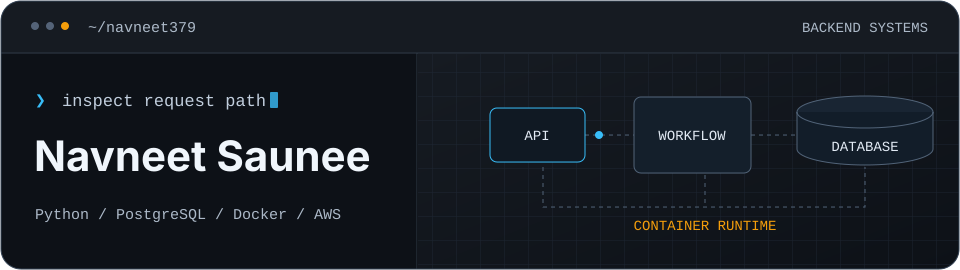
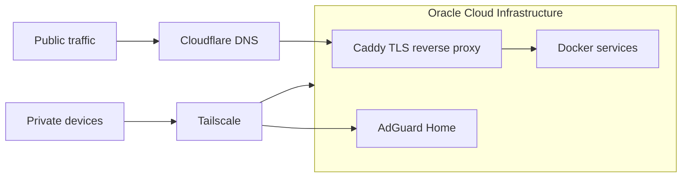

# Navneet Saunee

<!-- Role title: edit the bold line below. -->
**Python Backend Engineer**

I build reliable Python backends, design REST APIs, and optimize relational databases. I take the same interest in how a system is deployed, operated, and scaled as in how its code is written.

[Portfolio](https://navneets.dpdns.org/) · [LinkedIn](https://www.linkedin.com/in/navneet-saunee-8972aa200/)

> Every unindexed query eventually costs you a weekend.

## What I build

- **REST APIs** with clear contracts for applications and third-party integrations.
- **Relational data systems** with deliberate schema design, indexing, and query tuning.
- **Workflow and business systems** for dispatch, compliance, monitoring, and logistics.
- **Docker and AWS deployments** with an eye on how services behave in production.

## Selected production systems

<strong>Enterprise Digital Ticketing &amp; Field Compliance Platform</strong>

Built backend APIs for field ticketing, dispatch, inspection, and reporting. Structured the workflow modules and tuned PostgreSQL queries to support reliable access to operational data.

**Stack** · Python, Django, DRF, PostgreSQL, React, AWS

<strong>Child Online Safety &amp; Activity Monitoring Platform</strong>

Developed APIs for real-time activity monitoring, implemented authentication and authorization, and integrated automated safety alerts.

**Stack** · Python, Flask, AWS Lambda, Firebase, .NET, Flutter

<strong>Enterprise Warehouse &amp; Fleet Logistics System</strong>

Built Django services for stock transfers, route planning, and delivery milestones. Integrated the tracking interface with backend endpoints and tested the workflows for reliability.

**Stack** · Python, Django, DRF, AWS, JavaScript

## Technical stack

**Production experience**  
Python, Django, Django REST Framework, FastAPI, Flask, PostgreSQL, MySQL, Redis, AWS (EC2, S3, IAM, Lambda), Docker, Linux, Git

**Working knowledge**  
Celery, SQLAlchemy, Pydantic, MongoDB, Elasticsearch, SQLite, Oracle Cloud (OCI), Caddy, Tailscale, Cloudflare DNS, Scrapy, JavaScript

**Currently exploring**  
AI/ML, LLMs, RAG, AI Agents, React, TypeScript, DevOps/CI/CD, Cybersecurity

## Engineering lab

My self-hosted lab runs Docker services on OCI. Cloudflare DNS points public domains at Caddy, which terminates TLS and proxies requests to containers. Tailscale provides private access to the lab, including AdGuard Home for DNS.

View lab topology

## GitHub activity

Show contribution snake

[View my GitHub contribution calendar](https://github.com/navneet379#contributions)

---

*Off the clock, the Log Pose points toward the next systems rabbit hole. Mr. Robot on screen, synthwave, lo-fi, or an anime OST in the headphones.*
